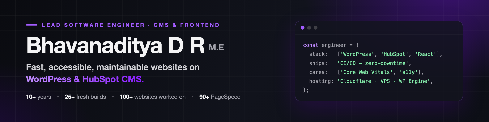

## Hi, I'm Bhavanaditya 👋

I'm a **Lead Software Engineer (CMS & Frontend / Hosting Support)** at [Mandy Technologies](https://www.mandytechnologies.com/) in Coimbatore, India. I've spent over a decade building fast, maintainable web products, from marketing sites to custom CMS platforms.

I'm a WordPress developer at heart, focused on performance, scalability and clean code. I build custom plugins, block-based themes and SEO-friendly front-ends with OOP PHP, React and SCSS, and I take them all the way to production: CI/CD, server migrations, DNS, hosting and Cloudflare. We build for [Vital](https://vitaldesign.com/), a digital agency in Portsmouth, NH, USA, and its clients worldwide.

- 🔭 Currently leading frontend architecture, WordPress and HubSpot CMS work, and hosting reliability
- 🌱 Writing about what I learn in production on [my blog](https://www.bhavanaditya.com/blog)
- 🤝 Open to select consulting and full-time opportunities in front-end and WordPress engineering
- ⚡ Fun fact: I treat my own personal site like production, with 2FA, passkeys and audit logs

| 🗓️ 10+ years | 🏗️ 25+ fresh builds | 🌐 100+ websites | 🚀 90+ PageSpeed | 🏆 4 awards |
| :---: | :---: | :---: | :---: | :---: |
| building for the web | built from scratch | worked on | with passing Core Web Vitals | at Mandy Technologies |

## 🧰 What I can do for you

| | Area | What that means |
| :---: | --- | --- |
| 🎨 | **Front-end** | Responsive, accessible interfaces in HTML, CSS/SCSS, JavaScript and React, built mobile-first |
| 🧩 | **WordPress and CMS** | Custom themes and plugins, Gutenberg blocks, WooCommerce, WP-CLI automation, HubSpot CMS themes and modules |
| ⚙️ | **Back-end** | OOP PHP, REST APIs, Git workflows and AWS-based environments |
| 🚀 | **Performance and SEO** | Core Web Vitals, caching, image and asset optimisation, technical SEO |
| ☁️ | **DevOps and hosting** | CI/CD with GitHub Actions and Bitbucket Pipelines, VPS and WP Engine hosting, Cloudflare, DNS, SSL, server migrations |
| 🧭 | **Technical leadership** | Code reviews, coding standards, mentoring, technical planning and release management |

## 🛠️ Tech stack

**Front-end**

**CMS and back-end**

**DevOps and hosting**

## 💼 Experience

| Role | Company | Dates |
| --- | --- | --- |
| **Lead Software Engineer**, CMS & Frontend / Hosting Support | Mandy Technologies | Jun 2026 – Present |
| **Frontend Developer**, client-dedicated | Vital Design (USA), via Mandy Technologies | Jun 2020 – Present |
| **Senior Frontend Developer** | Mandy Technologies | Jun 2020 – Jun 2026 |
| **Software Developer** | ColorWhistle | Feb 2018 – May 2020 |
| **Software Developer** | Aosta Software Technologies | Feb 2016 – Feb 2018 |

**What I do as a lead**

- Architect and build responsive front-ends, custom WordPress themes and plugins, and HubSpot CMS integrations
- Set coding standards, run code reviews and plan technical work
- Own releases through CI/CD and streamline deployment workflows
- Keep production healthy: uptime and performance monitoring, DNS, SSL, CDN, caching and security
- Run website migrations, platform upgrades and infrastructure improvements
- Mentor developers and work with design, strategy and account teams across time zones

Full timeline on [bhavanaditya.com/experience](https://www.bhavanaditya.com/experience).

## 🏆 Awards

| Year | Award | From |
| --- | --- | --- |
| 2025 | **Star Achiever** | Mandy Technologies |
| 2024 | **Top Contributor** | Mandy Technologies |
| 2023 | **Excellence Award** | Mandy Technologies |
| 2022 | **Excellence Award** | Mandy Technologies |

## 📌 Featured projects

| Project | What it does | Built with |
| --- | --- | --- |
| [DL Relocate DB](https://github.com/designslabz/dl-relocate-db) | Safely replaces URLs and text across a WordPress database during migrations, with AJAX progress and detailed logs | PHP, Webpack |
| [DesignsLabz Theme](https://github.com/designs-labz/designslabz-theme) | Developer-friendly WordPress theme built for Gutenberg, with native block support | PHP, SCSS, Webpack |
| [DL India Address Autofill](https://github.com/designs-labz/dl-india-address-autofill) | Fills in Indian city and state at WooCommerce checkout from the PIN code | JavaScript, PHP |
| [DesignsLabz Tools](https://github.com/designs-labz/designslabz-tools) | Tidies the WordPress admin and disables the theme and plugin file editors | PHP |
| [Image Resize](https://github.com/bhavanaditya/image-resize) | Batch-resizes a folder of images from the command line, with ImageMagick or GD | PHP |

## ✍️ Latest writing

- [Building a Personal Planner That Doesn't Suck: Recurrence, Time-Blocking, and Multi-Day Events](https://www.bhavanaditya.com/blog/building-a-personal-planner-that-doesnt-suck) · Sep 2026
- [The Small Things That Break When You Deploy Next.js Outside Vercel](https://www.bhavanaditya.com/blog/deploying-nextjs-outside-vercel) · Sep 2026
- [Treating a Personal Site Like Production: 2FA, Audit Logs, and Security Alerts](https://www.bhavanaditya.com/blog/treating-a-personal-site-like-production) · Sep 2026

More on [the blog](https://www.bhavanaditya.com/blog).

## 🎓 Education and certifications

| | Qualification | Where | When |
| :---: | --- | --- | --- |
| 🎓 | **M.E., Computer Science** | Kalaignar Karunanidhi Institute of Technology | 2017 – 2019 |
| 🎓 | **B.E., Computer Science** | Dr N.G.P. Institute of Technology | 2013 – 2016 |
| 🎓 | **Diploma, Computer Science** | Rudraveni Muthuswamy Polytechnic College | 2010 – 2013 |
| 📜 | **HubSpot CMS for Developers II: Best Practices** | HubSpot | Jul 2025 |
| 📜 | **Certified HubSpot CMS Developer** | HubSpot | Jun 2025 |

🗣️ **Languages:** English, Tamil

## 📫 Let's connect

Have a project in mind? I'm open to conversations about engineering leadership, WordPress, HubSpot and web performance.

Reach me through [my website](https://www.bhavanaditya.com/contact), on [LinkedIn](https://www.linkedin.com/in/drbhavanaditya/), or by [email](mailto:adityabhavan4@gmail.com).
