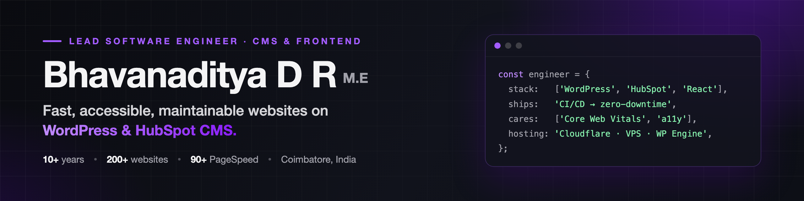

## About me

I'm a **Lead Software Engineer** at [Mandy Technologies](https://www.mandytechnologies.com/) in Coimbatore, India. I lead engineering for fast, secure WordPress and HubSpot websites, from the first commit to production.

Day to day, I set coding standards, review code, mentor developers, plan technical work, and own hosting, deployments and releases. We build for [Vital](https://vitaldesign.com/), a digital agency in Portsmouth, NH, USA, and its clients worldwide.

| 10+ years | 200+ websites | 90+ PageSpeed |
| :---: | :---: | :---: |
| in web development | delivered | with passing Core Web Vitals |

## Experience

| Role | Company | Dates |
| --- | --- | --- |
| **Lead Software Engineer**, CMS & Frontend / Hosting | Mandy Technologies | Jun 2026 – Present |
| **Frontend Developer**, client-dedicated | Vital Design (USA), via Mandy Technologies | Jun 2020 – Present |
| **Senior Frontend Developer** | Mandy Technologies | Jun 2020 – Jun 2026 |
| **Software Developer** | ColorWhistle | Feb 2018 – May 2020 |
| **Software Developer** | Aosta Software Technologies | Feb 2016 – Feb 2018 |

**What I do as a lead**

- Set coding standards and run code reviews across WordPress and HubSpot projects
- Plan technical work and own releases through CI/CD (GitHub Actions, Bitbucket Pipelines)
- Own hosting and production reliability: DNS, SSL, CDN, caching, Cloudflare, incident response
- Run zero-downtime migrations and platform upgrades
- Mentor developers and work with design, strategy and account teams across time zones

## Awards

| Year | Award | From |
| --- | --- | --- |
| 2025 | 🏆 **Star Achiever** | Mandy Technologies |
| 2024 | 🏆 **Top Contributor** | Mandy Technologies |
| 2023 | 🏆 **Excellence Award** | Mandy Technologies |
| 2022 | 🏆 **Excellence Award** | Mandy Technologies |

## Skills

| Area | Tools and practices |
| --- | --- |
| **WordPress** | Custom themes and plugins (OOP PHP), Gutenberg blocks, WooCommerce, WP-CLI |
| **HubSpot CMS** | Themes, custom modules, templates |
| **Frontend** | JavaScript, React, Angular, HTML5, SCSS, Webpack, REST APIs, accessibility (WCAG) |
| **Performance** | Core Web Vitals, caching, CDN, image and asset optimisation, SEO |
| **DevOps and hosting** | Git, GitHub Actions, Bitbucket Pipelines, SSH, VPS, WP Engine, AWS, Cloudflare |
| **Leadership** | Code reviews, coding standards, mentoring, technical planning, release management |

## Featured projects

| Project | What it does | Built with |
| --- | --- | --- |
| [DL Relocate DB](https://github.com/designslabz/dl-relocate-db) | Safely replaces URLs and text across a WordPress database during migrations, with AJAX progress and detailed logs | PHP, Webpack |
| [DesignsLabz Theme](https://github.com/designs-labz/designslabz-theme) | Developer-friendly WordPress theme built for Gutenberg, with native block support | PHP, SCSS, Webpack |
| [DL India Address Autofill](https://github.com/designs-labz/dl-india-address-autofill) | Fills in Indian city and state at WooCommerce checkout from the PIN code | JavaScript, PHP |
| [DesignsLabz Tools](https://github.com/designs-labz/designslabz-tools) | Tidies the WordPress admin and disables the theme and plugin file editors | PHP |

## Education and certifications

- **M.E., Computer Science**, Kalaignar Karunanidhi Institute of Technology · 2017 – 2019
- **B.E., Computer Science**, Dr N.G.P. Institute of Technology · 2013 – 2016
- **HubSpot CMS for Developers II: Best Practices**, HubSpot · 2025

**Languages:** English, Tamil

## Let's connect

I'm open to conversations about engineering leadership, WordPress, HubSpot and web performance. Reach me through [my website](https://www.bhavanaditya.com/contact), on [LinkedIn](https://www.linkedin.com/in/drbhavanaditya/), or by [email](mailto:adityabhavan4@gmail.com).
